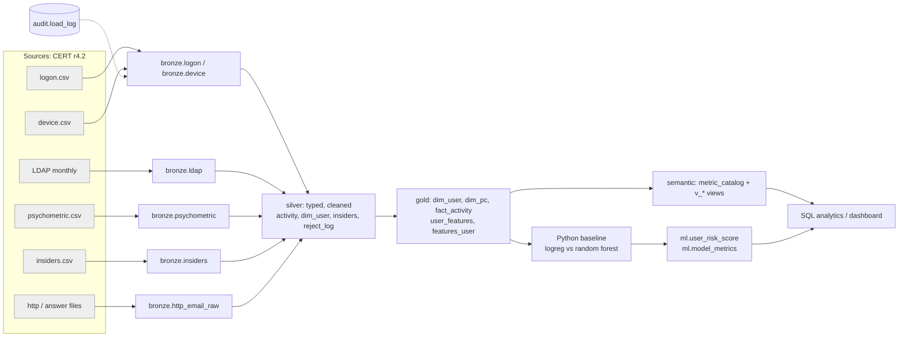

# Architecture

| Layer | Schema | Row counts (final database) |
|---|---|---|
| Bronze | `bronze` | device 405,380 / logon 854,859 / ldap 32,486 / psychometric 1,000 / insiders 192 / http_email_raw 6,765 |
| Silver | `silver` | device 405,380 / logon 854,859 / ldap 32,486 / psychometric 1,000 / dim_user 1,000 / insiders 191 / activity 1,264,397 / reject_log 0 |
| Gold | `gold` | dim_user 32,486 (should be 1,000, see KNOWN_ISSUES) / dim_pc 1,003 / fact_activity 42,147,175 (should equal silver.activity) / user_features 1,000 |
| Semantic | `semantic` | metric_catalog + 5 metric views |
| ML | `ml` | user_risk_score, model_metrics |
| Audit | `audit` | load_log |
